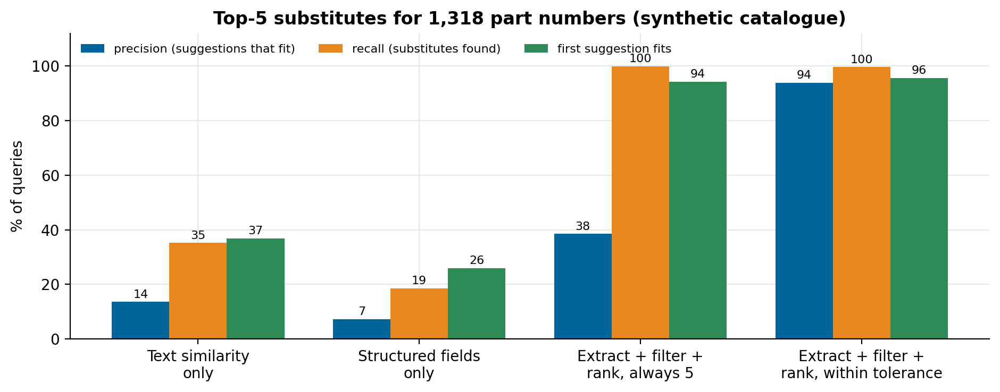

# Interchangeable parts search

Given a part number, find the parts that can replace it: why text similarity fails, and extract, filter and rank with a tolerance cutoff.

Companion code for the article **[How to find interchangeable parts with AI search](https://lucas.rangeltech.net/articles/h5-interchangeable-parts-ai-search/)**.

## The problem

A manufacturer with several plants carries the same component under many part numbers, described in different words and languages. Two parts are interchangeable only if they do the same job and fit: same family, thread and material class, critical dimensions within tolerance. Text that reads alike is not enough: an M20x1.5 and an M22x1.5 oil filter differ by one character.

This repository builds a messy synthetic catalogue (1,750 parts from five plants, aliases in two languages, threads written several ways, structured fields often empty, some near-miss variants) and compares four retrievers on the 1,318 parts that have at least one true substitute.

> All data in this repository is synthetic, generated by the scripts with a fixed seed, with the shape of a real client problem. No client data, names or code are included.

## What the code does

- **Text similarity:** TF-IDF on character n-grams (a stand-in for an embedding model).
- **Structured fields only:** exact match on the fields, nearest dimensions.
- **Extract + filter + rank:** normalise family, thread, material and dimensions from the text when fields are empty; filter on every critical attribute known on both sides; rank by dimension distance and text similarity.
- **The same, within tolerance:** only return candidates whose dimensions are within tolerance, even if that means fewer than five.

## Results

| Retriever | Precision (suggestions that fit) | Recall (substitutes found) | First suggestion fits |
|---|---:|---:|---:|
| Text similarity only | 14% | 35% | 37% |
| Structured fields only | 7% | 19% | 26% |
| Extract + filter + rank, always 5 | 38% | 100% | 94% |
| Extract + filter + rank, within tolerance | 94% | 99.6% | 96% |



## Run it

Python 3.11 or later.

```bash
pip install -r requirements.txt
python search.py
python figures.py figures
```

## Files

| File | What it is |
|---|---|
| `search.py` | catalogue generator, extraction, the four retrievers and the evaluation; writes `results.json` |
| `figures.py` | precision, recall and top-1 per retriever |

## License

Apache 2.0. See [LICENSE](LICENSE).
